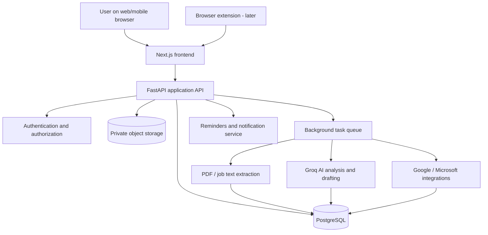

# CareerHub AI

**An AI-powered career management workspace for students and early-career professionals.**

> **About this document:** This is the original product specification and the long-term vision. It is **not** a description of what is built today: the stack below was simplified for the first release (Next.js + Supabase, no separate FastAPI/Redis services) and several modules are still to come. See the top-level [README](../README.md) for the current state and [LAUNCH_PLAN.md](LAUNCH_PLAN.md) for the build plan. The ETI 200 design-validation prototype is a separate milestone.

CareerHub AI brings job applications, resumes, cover letters, job descriptions, contacts, referrals, calendar events, reminders, interview preparation, and career insights into one connected workspace. It uses **Groq-hosted language models** for explanation and drafting while keeping the user in control of application decisions and external actions.

---

## Table of contents

1. [Vision and goals](#1-vision-and-goals)
2. [Who it serves](#2-who-it-serves)
3. [Full feature set](#3-full-feature-set)
4. [End-to-end user journeys](#4-end-to-end-user-journeys)
5. [Navigation and UX](#5-navigation-and-ux)
6. [Proposed technology stack](#6-proposed-technology-stack)
7. [Architecture and data flow](#7-architecture-and-data-flow)
8. [Data model](#8-data-model)
9. [AI design and evaluation](#9-ai-design-and-evaluation)
10. [Integrations and automation](#10-integrations-and-automation)
11. [API outline](#11-api-outline)
12. [Security, privacy, accessibility, and fairness](#12-security-privacy-accessibility-and-fairness)
13. [Delivery roadmap](#13-delivery-roadmap)
14. [Testing and acceptance criteria](#14-testing-and-acceptance-criteria)
15. [ETI 200 design-validation deliverables](#15-eti-200-design-validation-deliverables)
16. [Open decisions and future ideas](#16-open-decisions-and-future-ideas)

---

## 1. Vision and goals

### The problem

Job seekers juggle job boards, spreadsheets, email, documents, calendars, networking contacts, and interview notes. Important information gets duplicated or lost. Generic resume scorers often provide scores without useful evidence. Students with limited professional networks or career-search experience may be especially disadvantaged.

### The solution

An interconnected career workspace that:

- Tracks **every application and its full history**.
- Extracts relevant information from a **job posting URL, pasted text, or PDF**.
- Analyzes resumes and cover letters against a **specific job**, with cited evidence and actionable suggestions.
- Manages contacts, referrals, follow-ups, deadlines, and interviews.
- Offers a **Groq-powered AI copilot** that works with the actual application record.
- Provides transparent analytics, career planning, interview practice, and offer comparisons.
- Keeps sensitive actions **human-approved**; the assistant never silently submits applications, changes statuses, or sends messages.

### Product principles

1. **One source of truth:** Everything connects to an application, contact, document, or task.
2. **Actionable over decorative:** A concrete next step matters more than a generic AI score.
3. **Evidence over invention:** Never fabricate experience, skills, contacts, salary data, or employer responses.
4. **Transparency:** Show extracted text, score rubrics, source evidence, and uncertainty.
5. **User agency:** Every AI suggestion is reviewable, editable, and rejectable.
6. **Inclusive by design:** Support first-time applicants, career changers, international students, and users with accessibility needs.
7. **Privacy by default:** Minimize data collection, control access, and support export/deletion.

### Success indicators

- Users can find the status and next step of an application without searching other tools.
- Applications, contacts, notes, documents, and events remain correctly linked across sessions.
- Users can identify the evidence behind AI recommendations and correct mistakes.
- Fewer deadlines and follow-ups are missed in usability tests.
- Core workflows work without AI, external calendar access, or browser extensions.

---

## 2. Who it serves

### Persona A: First-time internship seeker

An undergraduate applying to internships with limited recruiter contacts. They have saved positions in browser bookmarks, tracked some applications in a spreadsheet, and forgotten which resume they used. They need a low-friction tracker, deadline reminders, clear job requirement explanations, and resume suggestions that do not invent experience. A failed product would bury urgent tasks under overwhelming metrics or require a paid integration to use basic features.

**Design consequences:** Quick-add application form, visible next actions, simple explanations, manual fallbacks, and a beginner-friendly default dashboard.

### Persona B: Adult career changer

A returning student with an academic or teaching background aiming to transition into a new industry, such as investment banking. They currently keep tailored resumes and networking notes in separate folders and manually map transferable skills to postings. They need evidence-based skill translation, targeted resume guidance, referral tracking, and a practical career-transition roadmap. A failed product would treat prior non-industry experience as worthless or make unsupported claims about career readiness.

**Design consequences:** Transferable-skills analysis, an editable accomplishment library, industry-specific job comparisons, and nuanced explanations rather than one opaque fit score.

These are **design personas**, not claims about real participants. Actual needs and assumptions must be validated with users.

---

## 3. Full feature set

The full product is organized into **16 connected modules**. Features labeled **Later** are in scope for the eventual product but not required for the first usable release.

### 3.1 Dashboard

- Summary cards: total applications, active applications, interviews, offers, rejections, tasks due, and referrals pending.
- Recent activity feed and application status breakdown.
- Upcoming deadlines, interviews, reminders, and recruiter follow-ups.
- AI-recommended next actions, with supporting reasons and user confirmation.
- Quick actions: add application, upload resume, import job, create contact, add note.
- Customizable filters for time period, career target, application stage, and priority.

### 3.2 Application tracker

**Views:** Kanban, searchable/sortable table, detailed record, calendar, and archived applications.

**Application fields:**

| Area | Fields |
| --- | --- |
| Employer | Company, industry, location, website, contact details |
| Position | Title, job ID, job description, posting URL, source, location, remote/hybrid/on-site, employment type |
| Compensation | Listed salary range, currency, benefits, user notes; distinguish posted vs. estimated amounts |
| Eligibility | Work authorization/sponsorship notes, required qualifications, preferred qualifications |
| Process | Application date, stage, stage history, deadlines, interview rounds, priority |
| People | Recruiter, hiring manager, alumni contacts, referral contacts, email/LinkedIn |
| Materials | Submitted resume version, cover letter version, transcript, portfolio, other attachments |
| Requirements | Requested documents, unanswered questions, assessments, other action items |
| Notes | Private notes, interview feedback, outcomes, links and supporting files |

**Default stages:** Saved → Preparing → Applied → Assessment → Interview → Offer → Accepted; with separate Rejected, Withdrawn, and Archived states. Stages may be customized. An application can have multiple interview rounds and multiple tasks.

**Behavior:**

- Create, update, archive, restore, and delete applications.
- Drag between stages with confirmation for consequential updates.
- Bulk operations and filters; duplicate detection by employer, role, and posting ID/URL.
- Chronological activity log with timestamps and actor/source attribution.
- Save the text of a job listing because the original URL may expire.
- Link multiple documents, tasks, contacts, and meetings to one application.
- Export tracked applications as CSV/JSON.

### 3.3 AI Application Copilot

A context-aware assistant scoped to an application or the user's approved workspace data.

- “What should I do next for this role?”
- “Summarize every contact with this recruiter.”
- “Which job requirements are not evidenced in my resume?”
- “Draft a polite follow-up based on the timeline.”
- “Prepare questions for my next interview.”
- “What changed in this application since last week?”

All generated actions are **proposals**. Display referenced record data and never automatically send, submit, delete, or misrepresent information.

### 3.4 AI Action Center

- Unified list of tasks, deadlines, missing documents, overdue follow-ups, assessments, and interviews.
- Suggested action, source application, why it matters, due date, and confidence/uncertainty.
- Filters: overdue, due soon, waiting on someone, completed, snoozed, dismissed.
- One-click transition to editing a draft, marking a task complete, or scheduling an event.
- Deduplicate similar reminders and avoid encouraging excessive follow-up.

### 3.5 Resume Studio

**Input:** PDF resume, optional pasted text, selected application and job posting (URL, text, or PDF).

**Workflow:**

1. Extract text and show it for user correction.
2. Parse structured sections (skills, experience, education, projects).
3. Identify job requirements and distinguish must-have from preferred.
4. Map each requirement to **quoted supporting resume evidence**, missing evidence, or unclear evidence.
5. Produce rubric-based feedback, an optional match score, and prioritized improvements.
6. Suggest truthful bullet point revisions and formatting changes; user approves edits.
7. Save a new version linked to the relevant application; preserve the original.

**Analysis dimensions:** job relevance, technical/domain requirements, experience evidence, clarity, measurable impact when genuinely supported, consistency, and PDF readability/ATS extraction risks.

**Important:** A match score is an internal guidance rubric, **not** a verified employer ATS score, hiring probability, or objective measure of worth. Allow users to view the score breakdown and turn scoring off.

**Extra features:** side-by-side version comparison, keyword context, transferable-skills suggestions, resume version history, evidence library integration, and exportable feedback.

### 3.6 Cover Letter Studio

- Upload a PDF or enter text; optionally generate a first draft from the job and approved career evidence.
- Evaluate relevance, specificity, evidence, clarity, structure, tone, and consistency with the resume.
- Show paragraph-level feedback, highlighted passages, suggested improvements, and an explained rubric score.
- Provide a revision editor with side-by-side comparisons and version history.
- Flag unverifiable statements or inconsistencies across the resume, letter, and experience library.
- Export reviewed text/PDF; never submit automatically.

### 3.7 Job Capture & Analyzer

- Import from a URL, pasted job text, or uploaded PDF.
- Extract company, role, posting ID, location, compensation if disclosed, deadlines, responsibilities, required/preferred skills, and application link.
- Display editable extraction results and source snippets.
- Mark uncertain fields for confirmation; avoid inventing missing salary, sponsorship, or deadlines.
- Detect potential duplicates and suspicious listings; make clear that warnings are not definitive fraud findings.
- Match requirements to the user's evidence and generate an application checklist.
- **Later:** Browser extension for one-click capture from supported job sites, with explicit permission and a manual fallback. Respect site access restrictions and terms.

### 3.8 Networking & Referral CRM

- Contact profiles: name, company, position, email, LinkedIn, relationship, where met, preferences, and notes.
- Links from contacts to one or more applications.
- Referral pipeline: not requested, requested, agreed, submitted, declined, unknown.
- Contact timeline: messages, meeting notes, next steps, last contact date.
- Draft networking emails, thank-you notes, and referral follow-ups for review.
- Contact reminders and duplicate detection.
- **Later:** Opt-in email sync; do not scrape private social networks.

### 3.9 Calendar & Reminders

- Internal calendar for interviews, assessments, deadlines, follow-ups, career fairs, and personal tasks.
- Configurable reminders, recurring review tasks, snooze, and notification preferences.
- Optional Google Calendar and Microsoft Outlook Calendar connection via OAuth.
- Time-zone-safe events; store canonical UTC timestamps and display in the user's local zone.
- Conflict detection and links back to related applications.
- Make create/update/delete behavior explicit; prevent sync loops and duplicates.
- If calendar access is denied, the built-in calendar and task list remain usable.

### 3.10 Interview Preparation

- Job-specific mock interview prompts, including behavioral and technical questions.
- STAR-format answer planning grounded in the user's real experiences.
- Role/company research notes with identifiable source links and dates.
- Written answer feedback on specificity, structure, and relevance.
- Interview round records, questions asked, interviewer notes, and post-interview debrief.
- Prepare thank-you note drafts and follow-up reminders.
- **Later:** Optional speech-based practice if explicit audio consent and appropriate storage controls are implemented.

### 3.11 Career Analytics

- Funnel by stage: saved → applied → assessments → interviews → offers.
- Applications over time, response rates, interview conversion, time in stage, and source effectiveness.
- Filters by role type, company, location, resume version, and time period.
- Distinguish missing data and unknown outcomes from confirmed rejections.
- Explain calculations and avoid unsupported causal conclusions (“version B caused more interviews”).
- Export reports for personal review.

### 3.12 Career Planning & Opportunity Prioritization

- Set target roles, industries, locations, pay preferences, work authorization constraints, and skills.
- Build editable learning milestones using skills evidenced by the user, desired role requirements, and realistic time constraints.
- Compare opportunities using user-adjustable weights (fit, interest, salary, location, timeline, sponsorship needs, etc.).
- Show **why** a job ranks highly; do not silently exclude opportunities based on inferred personal attributes.
- Support career changers with transferable-skills mapping and gap plans.

### 3.13 Document Vault & Skill Evidence Library

- Store resumes, cover letters, transcripts, certificates, portfolios, and approved work samples.
- Organize by category and job application; track names, versions, upload times, and file types.
- Keep a structured evidence library of projects, achievements, metrics, roles, tools, and links to proof.
- AI may suggest using existing evidence, but must not fabricate credentials or achievements.
- Preview and export files; control access; delete files and linked references safely.
- Apply malware scanning, file size limits, content-type checks, and secure storage.

### 3.14 Activity Timeline

- Append meaningful events to an application or contact: created, stage changed, document uploaded, interview scheduled, referral requested, note added, task completed.
- Include timestamp, origin (user/AI proposal/integration), and changed fields.
- View per-application timelines and an aggregate activity feed.
- Preserve an audit trail of AI-suggested changes that the user accepted or rejected.

### 3.15 Offer Comparison

- Compare salary, bonus, benefits, equity, location, travel, work arrangement, growth potential, and deadlines.
- Account for currencies and user-provided assumptions; distinguish base salary from total compensation.
- Custom weighting and transparent comparison tables.
- Save negotiation notes, decision criteria, and offer-related documents.
- No fabricated company benefits or salary information.

### 3.16 Settings & Integrations

- Profile, career goals, account security, notifications, and accessibility preferences.
- Connect/revoke Google and Microsoft integrations.
- Explain AI processing and allow opt-out where feasible.
- Export personal data and request deletion.
- Manage model settings and usage/cost limits where applicable.
- Display integration permissions and last successful sync.

---

## 4. End-to-end user journeys

### Journey A: Apply to a new job

1. Save a job from a URL, PDF, paste, or (later) browser extension.
2. Verify extracted fields; correct missing/uncertain details.
3. Create or link an application in **Preparing**.
4. Attach a resume version and run job-specific analysis.
5. Review cover letter suggestions and document checklist.
6. Submit the application **outside the platform** unless an explicitly authorized submission integration is eventually developed.
7. Mark as **Applied**, record the date and files actually submitted.
8. Generate user-approved reminders and track outcomes.

### Journey B: Manage a recruiter follow-up

1. Open the application detail page.
2. See last contact, timeline, related tasks, and referral status.
3. Copilot proposes a follow-up date and an editable email draft.
4. User confirms or revises; email is sent only through an explicitly connected and authorized workflow.
5. The event appears in the activity timeline and task list.

### Journey C: Prepare for an interview

1. Move the application to **Interview** and record time/round.
2. Create a calendar event; optionally sync to connected calendar.
3. Generate preparation questions based on the job posting and approved experience evidence.
4. Practice answers and review feedback.
5. Save a post-interview debrief and follow-up task.

### Journey D: Career changer tailoring materials

1. Add previous experience and projects to the evidence library.
2. Import a target job posting.
3. Identify transferable skills and genuine gaps.
4. Generate and review resume/cover letter edits.
5. Save a tailored version without changing the original.

---

## 5. Navigation and UX

### Proposed primary navigation

```text
CareerHub AI
├── Dashboard
├── Applications
│   ├── Kanban board
│   ├── Table
│   └── Application details + activity timeline
├── AI Action Center
├── Resume Studio
├── Cover Letter Studio
├── Job Capture & Analyzer
├── Contacts & Referrals
├── Calendar
├── Interview Prep
├── Career Analytics
├── Career Planner
├── Document Vault
├── Offer Comparison
└── Settings & Integrations
```

The **AI Application Copilot** appears as a contextual panel within application details and relevant workspaces rather than requiring a separate isolated data silo.

### UI standards

- Responsive desktop-first dashboard that also works on mobile.
- Consistent component library, keyboard accessibility, visible focus states, and high contrast.
- Table, board, and calendar views built from the **same application data**.
- Clear empty, loading, offline, error, and partial-extraction states.
- Explain destructive actions; support recovery where practical.
- Every AI-generated field visibly distinguishes **suggestion** from **saved record**.
- Use plain language and progressive disclosure: show essentials first, advanced controls as needed.

---

## 6. Proposed technology stack

| Layer | Proposal | Notes |
| --- | --- | --- |
| Frontend | Next.js + TypeScript | React-based application and routing |
| UI | Tailwind CSS + shadcn/ui | Accessible reusable components |
| Backend | FastAPI (Python) | API, document analysis coordination, integrations |
| Database | PostgreSQL | Transactional app data |
| ORM/migrations | SQLAlchemy + Alembic | Consistent with the Python backend; **not Prisma** |
| Authentication | Clerk **or** Supabase Auth | Choose one before implementation; enforce server-side authorization |
| AI inference | Groq API | Model selection/configuration must be verified during implementation |
| PDF extraction | PyMuPDF | Text extraction; scanned PDFs may need opt-in OCR support |
| File storage | Private S3-compatible storage | Encrypted, signed, short-lived file access |
| Background jobs | Redis + a Python task worker | Parsing, sync, notifications, retryable tasks |
| Email | Gmail API / Microsoft Graph (opt-in) | Scopes limited to approved needs |
| Calendars | Google Calendar API / Microsoft Graph (opt-in) | OAuth, sync state, error handling |
| Browser extension | Manifest V3 (Later) | User-initiated capture from supported pages |
| Monitoring | Structured logs + error reporting | Exclude resume and cover-letter content from logs |
| Testing | Pytest + Playwright + frontend unit tests | API, integration, E2E, accessibility |
| Deployment | Frontend host + Python API host + managed Postgres | Vendor choices remain open |

**Technical note:** Do not place `GROQ_API_KEY` or OAuth client secrets in the frontend or extension. All model calls originate from the server. Browser parsing, file extraction, and inference are distinct operations.

---

## 7. Architecture and data flow



### Core workflow: Analyze a resume against a posting

1. Authenticated user uploads a PDF to private storage.
2. Backend validates file size, format, ownership, and malware-scan status.
3. Worker extracts text, retaining page/section references where possible.
4. User checks extracted text and job requirements; the system records extraction uncertainty.
5. Backend sends the **minimum required text** to Groq through a server-side API call.
6. Model returns structured suggestions and requirement-to-evidence mappings; server validates the structure.
7. Rubric-based scoring, if enabled, is calculated transparently and stored with rubric/model/prompt version.
8. User reviews suggestions; edits are saved as a **new** document version only with approval.
9. Results link back to the application and appear in its activity timeline.

### Resilience

- Degraded mode if Groq is unavailable: applications, notes, uploads, tasks, and calendar still work.
- Background tasks are retried with backoff and idempotency protection.
- Job import supports pasted text if source sites block automated access.
- Failed syncs show an error state and never silently overwrite local data.

---

## 8. Data model

These are initial entities; exact SQL schemas and indexes will be defined during implementation.

| Entity | Purpose / key relationships |
| --- | --- |
| `users` | User identity, preferences, ownership scope |
| `career_profiles` | Target roles, preferences, authorization-related user notes |
| `companies` | Employer reference data |
| `job_postings` | Source URL, snapshot text, extracted requirements, attribution, extraction state |
| `applications` | User + company + posting, current stage, dates, priority |
| `application_events` | Immutable meaningful changes to applications |
| `tasks` | Application-linked and general actions, due dates, completion |
| `calendar_events` | Internal event, optional provider IDs and sync state |
| `contacts` | Recruiters, alumni, mentors, hiring managers |
| `application_contacts` | Contact-to-application role and relationship |
| `referrals` | Referral requests, contact, status and history |
| `contact_interactions` | Meeting/message/call notes and dates |
| `documents` | File metadata, type, owner, safe storage pointer |
| `document_versions` | Version history and application linkage |
| `experience_evidence` | User-approved accomplishments, projects, skills and claims |
| `job_requirements` | Parsed must-have/preferred criteria and source locations |
| `analysis_runs` | Input versions, model/rubric version, status, results |
| `analysis_findings` | Requirement, supporting evidence, uncertainty, suggestion |
| `interview_rounds` | Interview type, schedule, participants and debrief |
| `offers` | Compensation components, benefits and decision notes |
| `integration_accounts` | OAuth connection metadata, scopes, sync health |
| `notifications` | Delivery channels, deduplication and status |
| `copilot_sessions` | Context boundaries and approved conversation history |
| `audit_events` | Sensitive actions and approval provenance |

### Relationship rules

- All private records belong to a user or explicit authorized workspace.
- One application may have many tasks, contacts, referral events, interviews, documents, and timeline events.
- A document may have multiple versions; an application records **which version was actually submitted**.
- AI outputs refer to immutable input versions, so later document edits do not silently rewrite history.
- Provider IDs are stored separately from internal IDs to make integration retries safe.
- Deletion must account for dependent objects, object-storage files, connected-provider tokens, and audit retention requirements.

---

## 9. AI design and evaluation

### Groq responsibilities

- Explain job requirements and candidate evidence.
- Suggest clearer resume and cover letter language.
- Identify evidence gaps and possible transferable skills.
- Draft networking messages, recruiter follow-ups, and interview prompts.
- Summarize approved application history and propose next actions.

### Non-AI responsibilities

- Authentication and authorization.
- Accurate timestamps, reminders, and calendar event creation.
- File validation and PDF text extraction.
- Persistent storage, search, and status transitions.
- Deterministic matching/format validation where possible.
- Sending an email or updating an external calendar **only after user authorization**.

### Grounding and output contract

- Inputs should include the exact job posting snapshot and approved resume/experience data.
- Require structured output validated by backend schemas.
- Each requirement match should include `requirement`, `evidence`, `evidence_source`, `assessment` (`supported`, `unclear`, `not_evidenced`) and `explanation`.
- Unsupported job details and applicant credentials must be labeled **unknown**, not inferred as fact.
- Treat job posts, PDF contents, and emails as **untrusted input**; they must not override system instructions or initiate tool actions.
- Show the user the materials used in each AI result and allow corrections or reruns.

### Resume and cover letter scores

Scoring is optional, explained, and based on a published rubric. A sample **resume guidance rubric** (subject to validation):

| Category | Weight |
| --- | ---: |
| Evidenced match to essential job requirements | 35% |
| Role-relevant experience and projects | 25% |
| Clarity and specificity of accomplishments | 20% |
| Readability / extractability | 10% |
| Consistency and accuracy | 10% |

Scores are **not hiring predictions, actual ATS scores, or rankings of a person's worth**. Reviewers can inspect each contributing category and the evidence behind it. Missing data produces a limited or unavailable score rather than invented precision.

### AI quality checks

- Hallucinated employer details or user accomplishments.
- Unsupported conclusions about visas, salary, eligibility, or job offers.
- Unfairly discounting nontraditional backgrounds.
- Misleading confidence in keyword match scores.
- Prompt injection embedded in uploaded documents and postings.
- Privacy leakage across users or applications.
- Inconsistency between original resume, revised document, and cover letter.
- Cost/latency controls and retries during Groq outages.

---

## 10. Integrations and automation

### Google / Microsoft calendars

- Connect through explicit OAuth consent and narrow scopes.
- Display requested permissions before connecting.
- Support import and outbound event creation; add two-way sync only after conflict resolution is designed.
- Store provider sync tokens securely; revoke and disconnect on request.
- Respect timezone and daylight-saving changes.

### Gmail / Outlook

- Opt-in access to selected messages or limited metadata as permitted by provider scopes.
- Propose matching a thread to an application; ask the user to confirm ambiguous cases.
- Draft messages in-app. **Sending requires an explicit final confirmation.**
- Record links or metadata as appropriate; minimize storage of full email bodies.

### Job boards and browser extension

- Supported job-page capture for title, company, description, and source URL where site policies allow it.
- Source-site compatibility may vary; no promise of universal scraping.
- Always support manual entry, copy/paste, and PDF import.
- Do not auto-submit applications or circumvent site restrictions.

### Reminders

- User-set reminders plus proposed reminders based on known deadlines.
- Adjustable lead time and channels (in-app; email/push later).
- Avoid repeated notifications and duplicates; provide quiet hours and snooze.

---

## 11. API outline

Illustrative REST surface; request/response schemas to be finalized with implementation.

```text
GET    /api/me
GET    /api/dashboard

GET    /api/applications
POST   /api/applications
GET    /api/applications/{id}
PATCH  /api/applications/{id}
DELETE /api/applications/{id}
GET    /api/applications/{id}/timeline

GET    /api/jobs
POST   /api/jobs/import
GET    /api/jobs/{id}/requirements

POST   /api/documents/upload-init
POST   /api/documents/{id}/finalize
GET    /api/documents/{id}/versions

POST   /api/analysis/resume
POST   /api/analysis/cover-letter
GET    /api/analysis/{id}

GET    /api/tasks
POST   /api/tasks
PATCH  /api/tasks/{id}

GET    /api/contacts
POST   /api/contacts
POST   /api/referrals

GET    /api/calendar/events
POST   /api/calendar/events
GET    /api/integrations
POST   /api/integrations/{provider}/connect
DELETE /api/integrations/{provider}

POST   /api/copilot/sessions
POST   /api/copilot/sessions/{id}/messages
POST   /api/ai-proposals/{id}/approve
POST   /api/ai-proposals/{id}/reject

GET    /api/analytics/funnel
GET    /api/export
DELETE /api/account
```

General rules: validate inputs, enforce per-user authorization at every endpoint, paginate collections, use rate limits, implement upload scanning, and make external-write endpoints idempotent.

---

## 12. Security, privacy, accessibility, and fairness

### Security requirements

- Server-side authorization for every application, document, contact, analysis and event.
- Secret handling via environment or secret management; never commit API keys or tokens.
- Encryption in transit and at rest where supported by infrastructure.
- Private file buckets, short-lived signed URLs, file scanning, size/type limits.
- Safe PDF and URL processing, including SSRF defenses for URL import.
- CSRF/session protection as appropriate, validation, rate limiting, abuse prevention.
- Structured logs without raw sensitive resume text or third-party tokens.
- Incident response, backups, retention/deletion policies, and dependency updates.

### Privacy controls

- Explain what data is sent to Groq and third-party services.
- Ask consent before importing or syncing private email/calendar data.
- Let users edit, download, and delete their data.
- Minimize sharing of sensitive details; redact unnecessary personal data where feasible.
- Review third-party retention and processing terms before production launch.
- No background access to personal contacts without permission.

### Accessibility and fairness

- Target WCAG 2.2 AA usability patterns.
- Full keyboard navigation; screen reader labels; accessible errors and tables.
- Do not infer protected personal attributes or score applicants on them.
- Explain unclear or missing evidence instead of automatically rejecting candidates.
- Validate the experience across different job-search backgrounds and assistive technologies.
- Treat student career transitions and nontraditional experience as potentially relevant evidence.

---

## 13. Delivery roadmap

This is a phased **full-app build**, not a reduction to a single screen. Each phase has functioning end-to-end outcomes.

### Phase 0 — Product design and validation

- [ ] Finalize user journeys and information architecture.
- [ ] Validate the two initial personas with real users.
- [ ] Identify critical workflows and write testable hypotheses.
- [ ] Define data model, security model, and integration boundaries.
- [ ] Produce the ETI 200 design-validation artifact.

**Exit criterion:** Key assumptions, screens, and acceptance tests are documented and initial usability feedback is collected.

### Phase 1 — Functional foundation

- [ ] Application shell and responsive UI.
- [ ] Authentication, profiles, and secure data ownership.
- [ ] PostgreSQL schema and migrations.
- [ ] CRUD application tracker with Kanban, table, filters, and detail pages.
- [ ] Notes, task management, contact profiles, referral statuses.
- [ ] Internal calendar, reminders, and activity timeline.
- [ ] Document upload, storage, preview, and version linking.

**Exit criterion:** A student can manage a full application from saved through final outcome, with real persistent data and no AI dependency.

### Phase 2 — Groq-powered document intelligence

- [ ] Job text/URL/PDF ingestion with editable extraction.
- [ ] Resume and cover letter PDF extraction and validation.
- [ ] Structured AI analysis and evidence-grounded findings.
- [ ] Resume Studio with explained scores, suggestions, and version comparisons.
- [ ] Cover Letter Studio with evaluation, revisions, and consistency checks.
- [ ] Experience evidence library and comparison-to-job requirements.
- [ ] Background jobs, rate limits, failure states, and model evaluation suite.

**Exit criterion:** A user can import a job, upload documents, inspect trustworthy feedback, and save an approved revision without losing originals.

### Phase 3 — Copilot and workflow automation

- [ ] Application Copilot and per-application context.
- [ ] AI Action Center with explanations and approvals.
- [ ] User-approved networking and follow-up drafts.
- [ ] Google/Outlook calendar connections.
- [ ] Optional email integration with explicit confirmation for sending.
- [ ] Job capture extension for supported sites.
- [ ] Robust integration permissions, revoke, retry, and sync behavior.

**Exit criterion:** The app can suggest next actions, coordinate reminders, and synchronize permitted activity without performing unexpected external actions.

### Phase 4 — Career intelligence

- [ ] Interview Prep with practice and debriefs.
- [ ] Application funnel analytics and export.
- [ ] Career planning, skill gaps, and transferable skills.
- [ ] User-weighted opportunity prioritization.
- [ ] Offer comparison and decision support.
- [ ] Advanced reporting and personalization.

**Exit criterion:** Users can understand performance trends and plan the next steps of their career search using transparent, editable data.

### Phase 5 — Quality and release readiness

- [ ] Accessibility and usability audit.
- [ ] Security assessment and privacy review.
- [ ] Load tests, background-job reliability, cost monitoring, backups.
- [ ] Integration failure tests and documentation.
- [ ] Beta feedback, bug fixes, onboarding, and release checklist.

**Exit criterion:** The full application meets its reliability, privacy, security, and usability release criteria.

---

## 14. Testing and acceptance criteria

### Representative functional acceptance tests

| Scenario | Expected outcome |
| --- | --- |
| Create application | Persists after refresh and appears in board/table with correct owner |
| Change status | Board, detail, analytics, and timeline show the same state |
| Record referral | Contact, referral status, and application are correctly linked |
| Attach submitted resume | Exact document version is identifiable in application history |
| Import blocked job URL | User sees clear failure and can paste text manually |
| Upload unreadable PDF | User receives extraction warning and correction options |
| Resume analysis | Findings link to job requirements and actual resume evidence |
| AI proposes nonexistent skill | System labels as unsupported; user can reject; no silent resume update |
| Create reminder | Appears in internal calendar and task list at the correct timezone |
| External calendar unavailable | Local data remains usable; failed sync is shown |
| Draft follow-up email | Nothing is sent without user approval |
| Delete private document | Access is revoked and deletion workflow handles stored copies |
| Cross-user request | Unauthorized access is denied, including object-storage access |
| Groq outage | Non-AI tracking still works; analysis shows retryable error |
| Export data | Applications and associated user-owned metadata export correctly |

### Nonfunctional targets (to establish during testing)

- Fast navigation for core tracker tasks under expected student usage.
- Accessible keyboard and screen-reader experience.
- Clear progress indicators for long-running AI/document jobs.
- Search, import, and sync failures never cause silent data loss.
- Transparent per-analysis model usage/cost reporting for maintainers.
- No secret leakage, cross-user data access, or unauthorized external actions.

### Usability research

Recruit participants beyond the immediate team, including people with differing job-search experience. Observe completion of realistic tasks. Record task success, errors, uncertainty, time-on-task, and suggestions. Do not invent participant quotes or test outcomes.

---

## 15. ETI 200 design-validation deliverables

The larger app can be built in full, while **Sprint 4 Submission 1** still needs focused design evidence:

1. **Two stakeholder personas** with current stage, struggle, existing workaround, expected value/disruption, failure scenario, and an explicit design constraint.
2. **Prototype specification** describing one falsifiable hypothesis, in-scope interaction, deliberate exclusions, pass/fail threshold, and primary persona.
3. **Built design-validation prototype** (one screen/workflow step) created using PSU AI Studio or another permitted generative AI tool; export/screenshots/screen recording.
4. **3–5 sentence explanation** of the design question, pass/fail conditions, and what to change before user testing.
5. **Build reflection** documenting tools/prompts, process, surprises, and revisions.
6. **At least two assigned readings cited in APA style** in the PDF. Do not fabricate course-reading citations; use the actual assigned sources.

**Suggested focused hypothesis:** In an application detail view, a visibly sourced AI next-action suggestion helps students identify the most urgent real action more accurately than a bare status label.

**Suggested pass/fail threshold:** At least four of five usability participants identify the correct next action without prompting and can cite the record information that supports it; fewer than four, or acting on contradictory AI guidance, counts as a failure. These are **planned criteria**, not study results.

**Required assignment filename:** `LastName_FirstName_ETI200_Sprint4_Prototype.pdf`, plus separate build output. The full application can continue beyond that classroom submission.

---

## 16. Open decisions and future ideas

### Decisions to make before coding

- Choose **Clerk or Supabase Auth** (not both).
- Select the Groq-supported model(s), token budgets, structured output strategy, and fallback behavior at implementation time.
- Choose hosting, managed PostgreSQL, secure file storage, and notification delivery providers.
- Decide whether initial email integration is read-only/draft-only or includes user-confirmed sending.
- Finalize score rubrics through user research rather than treating arbitrary weights as authoritative.
- Set retention windows and deletion semantics for AI run inputs/outputs and backups.
- Define an extension permissions policy and supported job sites.
- Confirm university branding/permission: “Crestfield University” is a fictional classroom client unless explicitly authorized otherwise.

### Potential later enhancements

- Saved job-search queries and user-approved job discovery.
- Portfolio review and professional profile feedback.
- Alumni/mentor introductions with permission-based networking.
- Scholarship, fellowship, and graduate program application tracking.
- Multilingual document support with clear quality limitations.
- Collaborative career counselor review with granular sharing permissions.
- Offline-friendly mobile experience.

---

## Project definition of done

CareerHub AI is not complete merely because its screens look polished. A released feature must have real storage or integration where appropriate, useful empty/error states, authorization checks, accessible UI, automated tests, and a workflow that users can actually finish. AI recommendations must be evidence-based and editable, with clear distinction between **suggested**, **approved**, and **performed** actions.

**Current state:** This document is the specification. For what is implemented today, see the top-level README.
